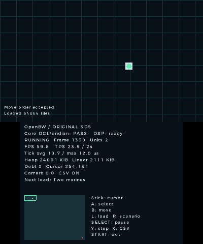
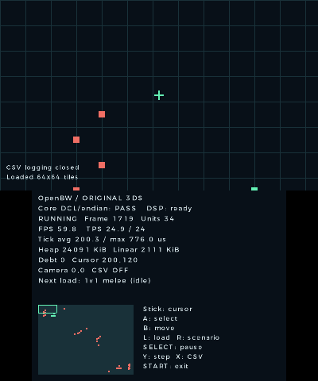
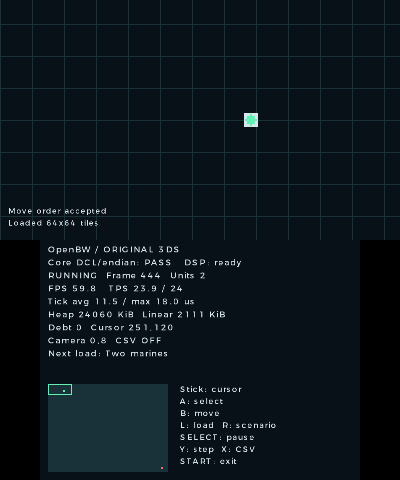

# Asset-backed validation — 2026-10-16

The user supplied classic game archives under the private, Git-ignored
`data files/` directory. No third-party game downloads were used. Only these
archives are needed by the current core: Patch_rt.mpq (984571 bytes),
BrooDat.mpq (23847431), StarDat.mpq (66184580). The larger CD containers remain
untouched. The test map is the user's installed `(2)The Small Divide.scm`,
64x64 tiles, copied privately as `maps/probe.scx` (32601 bytes).

Private data was staged into `nintendo3ds/local-data/3ds/openbw/` and the
existing Azahar SD directory. Neither the MPQs nor map contents are committed.
Only measurements, code and screenshots of our diagnostic renderer are tracked.

## Host integration

```sh
make -C nintendo3ds host HOST_CXX=clang++
python3 nintendo3ds/tests/assets.py --data 'data files' \
  --map '/Applications/StarCraft/Maps/(2)The Small Divide.scm' \
  --output nintendo3ds/reports/host-assets.csv
```

Each scenario completed **2400 actual OpenBW ticks**. The movement case invokes
the same engine select/move API used by A/B, then asserts the selected unit moved.
Observed movement: `(128,128) -> (256,128)`, exactly reaching the target.

| Scenario | Units at end | Load ms | Mean tick us | Max tick us |
| --- | ---: | ---: | ---: | ---: |
| Empty | 0 | 154.71 | 0.07 | 3.08 |
| Two idle marines | 2 | 152.27 | 0.16 | 5.92 |
| Selected marine moves | 2 | 154.26 | 0.18 | 15.38 |
| Two idle melee slots | 34 | 152.58 | 1.32 | 12.75 |

These are native macOS timings, not ARM11 performance estimates.

## 3DS executable in emulator

Azahar was temporarily configured with `is_new_3ds=false`, default flag false,
and the existing 100% emulated CPU-clock setting. The prior model settings were
saved and restored after testing. Old-mode emulation is useful functional
coverage; it is **not physical original-3DS benchmarking**.

All three modes loaded the actual MPQs/map in the ARM11 executable. CSV logging
recorded once per second, with no artificial simulation speed reduction and no
observed backlog. `emulator-assets.csv` contains the raw samples; the averages
below are means of the logged one-second samples, not CPU utilization.

| Scenario | Samples | Logged frames | Mean FPS | Mean TPS | Mean tick us | Worst tick us | Max heap bytes |
| --- | ---: | --- | ---: | ---: | ---: | ---: | ---: |
| Empty | 30 | 866..1564 | 59.76 | 24.00 | 7.80 | 199 | 24626240 |
| Two marines, including manual movement | 60 | 24..1444 | 59.83 | 24.00 | 14.73 | 347 | 24639144 |
| Two idle melee slots, 34 objects | 69 | 24..1660 | 59.83 | 23.98 | 177.30 | 826 | 24671216 |

Allocated normal heap remained around **23.5 MiB**. Linear usage was 2161664
bytes (about 2.06 MiB) in all logged samples. Normal/linear heap configuration
is still 40/4 MiB. These counters exclude code/stack/framebuffers and do not
capture loading peaks or establish real-hardware memory consumption.

Physical-input mapping was exercised through the testbed's controller inputs:

1. Circle Pad moved the cursor to approximately (131,131).
2. A selected the own marine at (128,128), visibly highlighting it.
3. Circle Pad moved the cursor to approximately (254,131).
4. B produced "Move order accepted"; the same highlighted marker moved from
   (128,128) to the destination. No mouse backend or synthetic mouse game events
   were used by the game. The touchscreen path remains minimap-only.





This functional test exposed an initial usability issue: after loading a base
away from the top-left corner, the camera could start far from the own units.
The updated build focuses the camera and cursor on the first own visible unit
on load. Host controls tests cover center/boundary placement. The updated ARM11
build passes the architecture check and all normal host tests. It was then
re-launched in old-3DS mode: the cursor focused at world (128,128), A selected
the marine immediately, and stick/B moved it to approximately (251,128).



## Build and remaining limits

Current .3dsx: `nintendo3ds/out/openbw-3ds.3dsx` (824796 bytes).
A private ready-to-copy SD directory, including executable and game data, is
`nintendo3ds/local-data/3ds/openbw/`; copy it to SD `/3ds/openbw/`.
SHA-256: `879f0e91a88030de487a1a57a9fca8344fda3d1e85336062ec3531777217fe4b`.
ELF sections: text 809624, data 7572, bss 30684 bytes (847880 total).
Final attributes: ARMv6K/MPCore, VFPv2, no Thumb-2/NEON. Existing upstream
Clang warnings remain; the cross-build and test suite pass.

No physical console tested. No opponent AI, controlled combat fixture,
resource/building command UI, genuine terrain/sprite rendering or multiplayer.
The melee mode's 34 objects include starting units/buildings and neutral map
objects, not 34 combat units. Touch injection is still not a verified console
test. Rendering uses simple colored diagnostic markers, not copyrighted art.
Next work is an original-console baseline and bounded terrain/sprite atlases.
