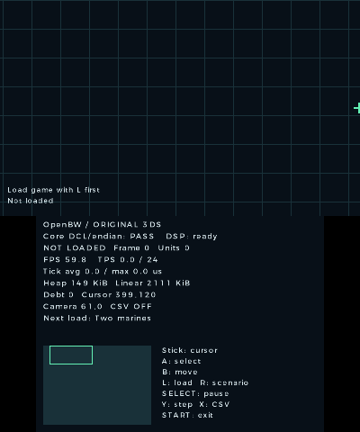

# Initial validation — 2026-10-16

This report records the initial smoke milestone before game data arrived.
For current asset-backed results, see [ASSET_VALIDATION.md](ASSET_VALIDATION.md).

Baseline upstream commit: `469d2037e2fd03085dac4729912f4188bc2a778b`.
Platform: macOS ARM64; devkitARM GCC 16.1.0; existing libctru/Citro2D/Citro3D.

## Compilation

1. Unmodified `web/wasm_sim_test.cpp` compiled and linked natively with Clang,
   GNU/C++14 mode, no SDL. It was not run with game data.
2. Initial ARM11 compilation of that same file failed in data_loading.h because
   get_length's deduced returns mixed int/unsigned int. Explicit `-> int` fixed
   this; the complete headless probe then compiled to `/tmp/openbw-arm11-sim.o`.
3. Full 3DS application build completed:

```sh
make -C nintendo3ds DEVKITPRO=/Users/karolynaz/devkitpro -j2
```

```text
text     data    bss     total resident sections
809320   7572    30684   847576 bytes
```

`nintendo3ds/out/openbw-3ds.3dsx`: **824492 bytes**.
SHA-256: `c2902fa8eac1bdb1e65d8429da945a31e9be7b28d2aa6e92e9b509e1d5216891`.
Normal heap/linear heap/stack configured as 40 MiB / 4 MiB / 256 KiB.
These budgets exclude code, static data and framebuffer allocations.

Final ELF attributes: ARMv6K / MPCore, ARM + Thumb-1, VFPv2, hard-float ABI,
no Thumb-2/NEON. Automated `tools/verify_arm11.py` passes. The stock SDK specs
initially brought in `_sync_dmb.o` (ARMv7 attributes; its text was GC-discarded).
The port's isolated specs select the SDK CP15 DMB helper instead; final
attributes now match ARM11. No SDK files were changed.

Host builds emitted seven existing upstream Clang warnings: deprecated sprintf
calls and memcpy into non-trivially-copyable types in state-copy code. No
upstream warning cleanup was mixed into the port. The port's ARM build passed.

## Host tests

```sh
make -C nintendo3ds test HOST_CXX=clang++
```

All passed:

- PKWARE DCL known-answer decompression (`AIAIAIAIAIAIA`, vector documented in
  [zlib's blast decoder](https://github.com/madler/zlib/blob/master/contrib/blast/blast.c)),
  unaligned little-endian read and fixed-point smoke checks.
- Exactly 24 ticks per second, fractional tick boundary, retained overload
  backlog and pause reset.
- Stick deadzone, bounded cursor, edge camera scrolling, minimap bounds,
  ignored touches outside minimap, and touch not moving the virtual cursor.
- Oversized/duplicate/truncated/missing DIM rejection before asset allocation.
- A valid 32x32 dimension header with missing assets returns an error naming
  Patch_rt.mpq rather than crashing.

Host sizeof(state/unit_t): 47720 / 976 bytes.
Target sizeof(state/unit_t) in the initial emulator smoke build: 38740 / 716.
These values do not include dynamic allocations.

## Emulator observations

Emuautotest/Azahar successfully launched the actual .3dsx, including the final
ARMv6K-link variant. The target's embedded core self-test displayed PASS.
Both screens drew; Circle Pad moved the cursor and scrolled the camera. In the
saved capture cursor=(399,120), camera=(61,0), selected load mode=Two marines.
A and B before loading display an instruction to load game files; L with no
SD map reports the file-open failure and keeps the UI responsive. R cycles the
next scenario. START stopped emulation (RPC disconnected; game FPS=0); the
emulator process was subsequently closed using the testbed.

At idle without a loaded game:

- App HUD: approximately 59.8 FPS, TPS=0, tick time=0.
- Emulator RPC sample: 60.05 FPS, 100.4% emulation speed.
- App allocated normal heap approximately 149 KiB; linear usage 2111 KiB.
  These do not represent whole-process or peak game memory.

Touch events sent by the testbed did not visibly move the camera; its reported
window geometry was only 100x62, so OS-coordinate touch injection was not a
reliable integration test. Minimap-only routing passes the host controller
tests; physical touchscreen behavior still needs a console or reliable HID
injection test. Do not report it as hardware-verified.



## Not measured / not established

| Scenario | Asset load | 3DS simulation TPS | Tick time | Peak RAM | Gameplay |
| --- | --- | --- | --- | --- | --- |
| UI/core smoke | no assets needed, PASS | 0 (no game) | N/A | not measured | input shell tested |
| Empty map | waiting for user data | not measured | not measured | not measured | not tested |
| Two-unit movement | waiting for user data | not measured | not measured | not measured | commands compiled only |
| Small combat | not yet implemented as a controlled fixture | not measured | not measured | not measured | not tested |
| Idle 1v1 melee | waiting for user data | not measured | not measured | not measured | no opponent AI |
| Full 1v1 + AI | future milestone | not measured | not measured | not measured | not implemented |

No original 3DS/2DS device was available. Emulator UI FPS cannot establish
original-hardware simulation performance. All game initialization, unit order,
terrain/atlas and gameplay validation remains dependent on the user's data.
No Blizzard assets were downloaded, copied, committed or distributed.
